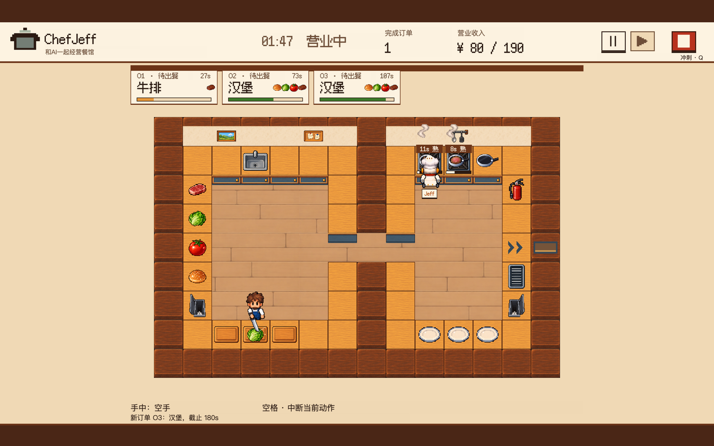

# ChefJeff · Cooking with AI

English · [中文](README.zh-CN.md)

> **Online access update (2026-10-30):** The original domain, `chefjeff.online`, is undergoing ICP filing in China and is temporarily unavailable during review. Play at **[China · Shanghai](https://chefjeff.belchingleo.online/)** or **[Overseas · Germany](https://global.belchingleo.online/)**.

What can't be computed? We seem to have been asking this ever since computers appeared: what can a computer not do?
My first answer was cooking. Does a computer know how to cook? Now we can ask: can an AI cook?

ChefJeff is a real-time cooking game in which a person and an AI cook together, and an extensible environment for human–AI collaboration experiments. Putting a person and an AI in one kitchen, it tests cooperation rather than competition. We want to offer a visual environment for understanding a world that people and AI share, and to grow an open human–AI collaboration benchmark together with the open-source community. Researchers in human–computer interaction, human factors and human–machine communication are welcome to use it in their own studies.



Where to start: [play online](#play-online) · [run it locally](#run-it-locally) · [connect your own model](#jeff-and-model-integration) · [change the configuration](#five-data-models) · [the environment and benchmark](#building-a-humanai-collaboration-environment-and-benchmark)

> Current version: **0.9.0-beta.1**, the sixth public test release. You need your own model API, and interfaces and analysis rules may still change. We suggest starting with Jev models: they don't play especially well, but they are cheap. Results from other models are welcome.

---

## Play online

Choose the [China site (Shanghai)](https://chefjeff.belchingleo.online/) or the [overseas site (Germany)](https://global.belchingleo.online/) to play; nothing to install.

- Bring your own model key: choose a service under Settings → AI teammate and paste the key. By default the key stays in that page and your browser sends it straight to the provider; only Jev goes through the demo server, and only if you agree. The [model connection guide](https://chefjeff.belchingleo.online/model-guide.html) lists the services that work and roughly what a round costs.
- Before your first round you are asked whether to contribute anonymous round data; you can change your mind at any time. Contributions are kept for at most two years and can be deleted with a deletion receipt; once the research is published, de-identified data may be made public; see [privacy and contact](https://chefjeff.belchingleo.online/privacy.html).
- Use the keyboard on a computer, and touch controls on a phone held landscape (see [touch controls](#touch-controls-experimental)). On iPhone, choose Add to Home Screen in Safari's share menu and open it from there to play full screen.
- The game servers are in Shanghai and Germany; contributed round data and aggregate usage statistics are stored in Shanghai. The number of kitchens open at once is limited, and a full kitchen asks you to come back shortly.
- Maintainers can deploy the separate, authenticated [research admin console](https://github.com/belchingleo/ChefJeff/blob/main/docs/research-admin.md) for private record previews, selected exports, charts and regional attribution. It is not a public data browser.

---

## Run it locally

You need Python 3.10 or later, a computer with a keyboard, and a browser that supports WebGL. The backend uses only the Python standard library. The web client is already built and included in the repository, so you don't need to rebuild it just to play.

```sh
git clone https://github.com/belchingleo/ChefJeff.git
cd ChefJeff
python3 scripts/launch_web.py
```

On Windows, use `py -3 scripts/launch_web.py`. You can also double-click `start-web.command` (macOS) or `start-web.bat` (Windows).

Then open <http://127.0.0.1:8775/> in your browser, enter your model API details under Settings, and start a round once the connection test succeeds. Settings list ready-made services in two groups: decision models (TypeSafe Jev, any OpenRouter decision model, StartLux-Decision via Bamboo Relay, or a decision model running on this computer, local game only), which score every available action directly, and chat models (DeepSeek, OpenRouter chat models, Alibaba qwen-flash, Doubao Seed 2.0 lite, Gemini 3.5 Flash-Lite, Cloudflare Workers AI, Zhipu GLM-4.7-Flash), with the address, model name and thinking switch filled in; each shows its rough cost per round and whether a full round has been tested. Any other Chat Completions-compatible service can be entered by hand; check for yourself that it returns actions in the required format and responds quickly enough. See the [model connection guide](docs/model-guide.md).

StartLux-Decision is available locally and online through the third-party [Bamboo Relay](https://bamboonode.dev/), which offers a free testing quota. Its preset uses `https://api.bamboonode.dev/v1/decisions` and editable model name `startlux-decision-27b-autothink`; online requests go directly from the browser to Bamboo Relay. Both versions send `allow_none: false` so the model chooses a listed action, and `think_mode: never` to disable thinking by default. No developer connection with a real key or full round has been tested. See the [website](https://decision.startlux.com/) and [API docs](https://github.com/StartLuxLabs/StartLux-Decision/blob/main/docs/api.md).

End the round and stop the old server with `stop-web.command` before launching an updated download; see the [model guide](docs/model-guide.md).

> **About costs**: the connection test and every round use your own model account, and that account pays for the calls. By default a round makes at most 200 calls (adjustable from 1 to 2000). This limits the number of calls, not the amount of money. This is a real-time game and the kitchen never stops, so if the model is too slow, Jeff spends most of the round standing still, thinking.

Tested so far: macOS 15.6, Python 3.12, a Chromium-based browser, with TypeSafe Jev (jev-latest) and DeepSeek V4.1-Flash as models. Other systems and models have not been checked one by one yet; reports are welcome.

**Phone trial (experimental):** open an accessible hosted game or a separately configured computer on your network in a WebGL-capable browser, then turn the phone to landscape. The phone is a browser client; Python still runs on the computer or server. Your phone's `localhost` does not point to your computer. The desktop launcher alone does not make the service reachable from other devices; see [hosted deployment](docs/hosted-deployment.md) and [device support](docs/device-support.md).

---

## How the game works

ChefJeff plays much like Overcooked: two chefs cook together. The difference is that the other chef is controlled by an AI.

You control one chef with the keyboard, experimental desktop controller support or experimental landscape touch controls: walk, fetch ingredients, chop, cook, plate, serve and wash plates. Jeff is the other chef, driven by a large language model, and every few seconds he decides what to do next. You share one kitchen and the same physical rules (walking speed, throwing distance, collisions), but you see the kitchen and act in it in different ways; see [Jeff and model integration](#jeff-and-model-integration).

A round lasts 180 seconds. As in Overcooked 2, two orders wait from the start, another comes at regular intervals and one at once whenever fewer than two wait, up to five at a time; so the faster you serve, the sooner the next order comes. Each order has its own countdown: an order that runs out costs you money and stays, its countdown starting again. Reaching the target does not end the round early: the kitchen stays open until closing time, and net revenue at closing earns one star at the target, two at 1.5 times it and three at twice it.

| Level | Menu | What's special | Target |
| --- | --- | --- | --- |
| Level 1 · Steak | Steak ¥50 | Practice level: learn to chop, fry, plate and serve | ¥200 |
| Level 2 · Burger | Burger ¥80 | A long counter splits the kitchen in two, so a lot has to be passed across it | ¥160 |
| Level 3 · Steak and burger | Steak, burger | Two stoves and three frying pans; both dishes at once | ¥140 |
| Level 4 · Across the counter (switched off for players for now, `level_switches.json`) | Steak, burger | A row of counters runs from wall to wall: one side has the ingredients, stoves and serving window, the other the boards and sink, so every dish needs both chefs | ¥90 |
| Level 5 · Swapped sides (switched off for players, `level_switches.json`) | Steak, burger | Level 4 with the chefs swapped: the player fetches, cooks and serves, Jeff chops and washes | ¥90 |

Working together, you chop, cook, plate and serve between you. Along the way Jeff may pass you dishes, or chop, pass and wash up alongside you. He may also bump you aside to handle something himself, and you can do the same to him.
If the model isn't doing what you want, press 1–6 to tell Jeff what kind of work you'd like to do, or that he just made a mistake.

The controls work much as in Overcooked:

| Key | Action |
| --- | --- |
| WASD or arrow keys | Move; press **Shift** while moving to dash |
| Space | Take and put, Overcooked 2's pick-up key: fetch, pick up, put down, put in the pan, plate, serve. It acts on press, even with an item in hand |
| E | Chop, wash and throw, Overcooked 2's chop/throw key (left Ctrl there; in a browser Ctrl with W closes the tab): chop at a board, wash at a sink, spray with the extinguisher; with a throwable item a tap throws it straight ahead. Space never chops, washes or throws |
| Hold E | Holding a throwable item, hold for about 0.3 s to aim, whether facing a station or open floor. Your chef stops and a translucent curved guide shows direction and range; turn it with the direction keys and release to throw. It flies to full range (4 tiles) that way, or to Jeff if he stands in its path; as in Overcooked 2, a raw or chopped ingredient that comes down on an empty board or counter rests there, and one that comes down in an empty pan that cooks it goes in. The extinguisher cannot be thrown |
| 1–6 | Tell Jeff what kind of work you want to do, or point out a mistake |
| Enter | Bookmark the current moment without pausing or interrupting anything; bookmarks are included in the data export |
| Esc or P | Pause (use P on iPad keyboards without an Esc key). Settings let you connect a model, switch language, adjust volume and export the run |

### Touch controls (experimental)

Phones and small touch screens need landscape:

| Touch | Action |
| --- | --- |
| Joystick, lower left | Move; let go to stop. Press anywhere in the lower-left area and the stick moves under your thumb |
| Take/Put | Like Space: takes or puts down what is in front of you at once (also to cook, plate and serve), even holding an item; it never throws |
| Chop/Wash/Throw (above Take/Put) | Like E: chops at a board, washes at a sink, sprays with the extinguisher; holding a throwable item, tap to throw straight ahead, or hold to aim (steer with the joystick) and let go to throw; while aiming, slide onto the round Cancel and let go to cancel |
| Dash | Press while moving, like Shift on the keyboard |
| Top buttons | Communication (like keys 1–6), bookmark, pause, settings and the round record |

**Desktop controller trial:** a browser with the Gamepad API (Chrome first) on `localhost` or HTTPS can use one controller: one that reports the `standard` mapping, a pair of Joy-Cons that macOS merges into one "Joy-Con (L/R)", or one left or right Joy-Con held sideways in Safari. Press a button if the browser has not discovered it. The buttons follow Overcooked 2. Left stick/D-pad moves; A/× takes and puts, like Space; X/□ chops, washes and sprays, like E, and with a throwable item a tap throws straight ahead, while a hold of about 0.3 s aims (steer with the stick) and releasing throws; B/○ dashes while moving. As in Overcooked 2, no button cancels an aim. One Joy-Con held sideways: the right button takes and puts, the left button chops, washes and throws (hold to aim), the bottom button dashes, and − on the left Joy-Con or + on the right one pauses and resumes. Start/Options starts a ready round (or opens model Settings), pauses or resumes; on the result card Start or A goes on to the next round. Settings, communication and menus still use keyboard/mouse. Interruptions clear controller input; center the stick and release buttons before taking control again, with manual resume after a pause. See [device support](docs/device-support.md) and [interaction guide](docs/interaction-guide.md).

After each round the result card stays on the kitchen with the income against the goal and two big buttons, **Try again** and **Next level**; the next level leads after a win (Space, Enter, A/Start or the phone's main button; a short 3·2·1 and the round starts at the same pace). **Round record** opens the full record, which shows how many times you and Jeff each fetched ingredients, chopped, cooked, served and washed plates, and each chef's contribution, delay and idle time (see [records and analysis](#records-and-analysis)).

The game has Chinese and English interfaces, with 8-bit style music and sound effects. A dash starts at 2× speed and eases back to walking over 1 second, ready again when it ends.

With the touch layout active, turning the device to portrait, hiding the page or losing the connection clears held input and pauses a running round. Return to landscape and choose Resume; the game does not resume itself. Browsers cannot always force landscape orientation. Touch support is experimental: it has been played on a real iPhone; Android Chrome has not yet been checked on a real device. See [device support](docs/device-support.md), [interaction guide](docs/interaction-guide.md) and the [current rules](docs/current-rules.md).

---

## Technical foundations

### Five data models

"Model" here means a content configuration, not an AI model:

- **Map**: where the walls, counters and equipment are, and which side each one is worked from.
- **Recipes**: which ingredients exist, which need chopping and which need cooking, what each dish is made of (four ingredients at most) and what it sells for.
- **Orders**: which dishes come in, how often, and how long each order can wait.
- **Equipment**: what each type of equipment does, how fast, and whether two chefs can use it at once.
- **Level**: combines the other four, plus the plates and pans at the start, the target revenue and the random seeds.

All of these are JSON files in `content/` and `maps/`, validated against `schemas/`. Rules shared by every level, such as movement, throwing and penalties, live in `rulesets/`. The web client also reads ingredient, dish and equipment names from this data. Within the mechanics that the current engine and schemas support, a new level is made by combining these configurations, with no special code for any level. Gameplay beyond the existing mechanics still requires extending the engine. See the [configuration contract](docs/architecture/configuration-contract.md).

### Jeff and model integration

Jeff doesn't see the screen. He reads a structured game state and picks one of the actions that are legal right now:

```
Current kitchen state (orders, workstations, items on the floor, what each chef is doing)
        + rule descriptions + every action available right now
        ↓
      The model picks one action (for example "chop b1" or "assemble ground F2")
        ↓
      The kitchen engine checks that the action is legal, runs it, and writes the result to the event log
```

- **Different observation and control, the same abilities.** You press keys in real time and move step by step. Jeff picks whole steps such as "fetch", "chop" or "serve", and the engine walks him there and carries them out. He can do only what your controls can: the same throws (a direction, or toward you), the same hand swaps, no shortcuts such as emptying a pan in place. Tests compare his options with yours.
- **The default rule descriptions state only facts.** Everything sent to Jeff is in English, and the two chefs are always called `human` and `jeff`. The rules say what can be done and what will happen. They don't assign roles or suggest how to cooperate.
- **Two other inputs are run conditions.** The messages you send with 1–6, and summaries of earlier rounds from rolling cross-round memory (on by default; it can be turned off or cleared in Settings), are also sent to Jeff. When rounds are analysed, these are recorded separately from the rule descriptions.
- **Every decision is logged.** What was chosen, whether it was accepted and whether it was completed are recorded separately, so you can check afterwards what actually happened.

To connect your own model, implement two methods, `payload(state, actions)` and `ask(payload)`. See [agent integration](docs/agent-integration.md).

### Records and analysis

1. **Round records and replay**: when a round starts, its configuration is frozen and hashed; from then on every step is stored as one event stream, together with the player's inputs. `python3 collaboration_analyzer.py logs/sessions/<round id>` replays the round without calling any model and checks the replay against the original record. Replays are only guaranteed to match within the same version; a round recorded by an older version may replay differently. See [session records](docs/architecture/session-record.md).
2. **Item history and collaboration analysis**: the engine records whose hands every ingredient, plate and pan has passed through. Using the rules as currently defined, tracing back from each served dish shows how every action contributed to it. On top of this, the round record reports three measures; they are experimental, and feedback on whether they look right is welcome:
   - **Contribution**: each chef's share of the standard time of the served dishes. Standard time = the configured work of each step (2.2 s to chop, 2 s to wash a plate, and so on; picking up and putting down are instant) + the shortest walk needed to carry things. Cooking counts for no one, and neither do dawdling or detours.
   - **Delay**: how many seconds later than ideal each dish went out. Ideal means the same steps at standard time, each started as soon as its inputs are there (without taking a chef away from other useful work). The delay is split by how much each chef would have saved by working ideally (Shapley values), so shared slowness is divided.
   - **Idle**: time on actions that were never used (such as swapping items back and forth) and waiting. The player's own walking cannot be told apart, so the player's idle time is a lower bound.

   These results can be recomputed exactly, but whether they reflect good cooperation still needs human interpretation. For example, ingredients prepared early but left unused because the orders changed don't mean the preparation was pointless at the time. The idea draws on the CCE metric from AgentWorld (arXiv 2609.31590); see [collaboration analysis](docs/architecture/collaboration-analyzer.md).

3. **How Jeff decided**: `python3 scripts/decision_stats.py logs/` reads the local round logs and counts, for each model: close calls between its top two options (decision models report probabilities), actions Jeff replaced with its own next choice before they were done, back-and-forth between two targets (A → B → A) and, with Jeff's plan on, how many of its actions belonged to the plan's part. It also reads research packages pulled with `scripts/pull_research.py` (an expired package is refused) and downloaded round records; there the model is the one the browser reported, and how a plan ended is not recorded. It also reports how long Jeff stood between two steps, in wall seconds, split into the wait before the first request, earlier answers that started nothing and the reply that started the next step, with rounds grouped by whether `ai_ask_on_step_end` was on. It also counts finished steps that Jeff's next ones undid: an item put down and taken straight back, and walks that return to where they began. It only reads and calls no model. The report names models, so keep it private like `logs/`.

### Code layout

Every Python module at the repository root, in seven groups. **Run** marks a module you start directly with `python3 <module>`; the others are imported. **Switch** names the `features.json` switches a module implements; `features.json` gives each switch its stage (released or on trial) and whether it is on.

**Engine: rules, maps and levels**

| Module | What it does |
| --- | --- |
| `kitchen.py` | Deterministic kitchen rules: every station, recipe, duration and penalty comes from one frozen configuration, with no per-level branches |
| `spatial_kitchen.py` | The same kitchen rules on a walkable grid, with no AI policy |
| `rules.py` | Runtime rule tables derived from one frozen resolved configuration |
| `config_contract.py` | **Run.** Validate, resolve and freeze a level bundle; `python3 config_contract.py level-2` prints the diagnostics and the configuration hash |
| `schema_check.py` | Standard-library validator for the JSON Schema subset used in `schemas/` |
| `map_definition.py` | Versioned map documents shared by the renderer and the simulation: validate, save, load |
| `navigation.py` | Per-map walking routes; switching levels changes no global geometry |
| `levels.py` | **Run.** Authored level lookup and which levels players see (`level_switches.json`, then this machine's override); `python3 levels.py show`; `set LEVEL on\|off` writes the override (`/etc/chefjeff/levels.override.json`, or the path in `CHEFJEFF_LEVELS_OVERRIDE`), not `level_switches.json` |
| `level_design.py` | Turns a level-editor design (room size, walls, stations, dishes) into a level bundle |
| `level_calibration.py` | Order pacing and target money for a player's level, measured with the scripted reference chefs |
| `player_level_queue.py` | Runs those calibrations one at a time in a separate lower-priority process, away from the kitchens being played |
| `reference_policy.py` | A deterministic recipe-following scripted chef for regression traces and calibration; not an AI teammate |

**Jeff's input and its `features.json` switches**

| Module | What it does |
| --- | --- |
| `harness.py` | Everything Jeff is shown: the rule text, the kitchen as the model sees it, the listed actions, recent events and decisions, player messages and memory |
| `model_language.py` | The versioned English catalog (`model-language-en-v4.json`) that turns the engine's text into what Jeff reads |
| `cooperation_memory.py` | Cross-round memory: bounded factual records of earlier rounds, not inferred player preferences |
| `features.py` | **Run.** Reads and checks `features.json` and a server's override; `python3 features.py show`, `check [FILE]`; `set NAME on\|off` and `unset NAME` write the override (`/etc/chefjeff/features.override.json`, or the path in `CHEFJEFF_FEATURES_OVERRIDE`), not `features.json` |
| `one_press.py` | **Switch** `one_press`, `throw_to`. Several presses offered as one option (put then take, put then chop, …) and carried out as ordinary steps |
| `links.py` | **Switch** `option_links`, `option_links_partner`. The work each option makes possible, worked out on a fork of the kitchen |
| `ask_ahead.py` | **Switch** `ask_ahead`. Asks Jeff for his next step before the current one ends, from the kitchen played forward |
| `undo_note.py` | **Switch** `undo_note`. An option that would bring back how things were before one of Jeff's last steps says so |
| `reach_note.py` | **Switch** `reach_note`. On a split floor, which stations each chef can walk to |
| `split_floor.py` | **Switch** `split_floor`. On a split floor where no dish on the menu can be made by one chef alone, Jeff is told so |
| `burn_note.py` | **Switch** `burn_note`. An option on a stove with food says when it is cooked and when it burns, or that it waits while the stove burns |
| `option_notes.py` | **Switch** `option_notes`. Options that pick up or serve a finished dish say which waiting order it goes to and how long that order has left |
| `step_check.py` | **Switch** `step_check`. For each kind of step the waiting orders need, whether the kitchen allows it now and what stands in the way |
| `walk_note.py` | **Switch** `walk_note`. Every walking option says how many seconds of walking it is |
| `go_note.py` | **Switch** `go_note`. A "go X" option says when nothing at X takes what Jeff holds |
| `work_notes.py` | **Switch** `own_chain`, `plate_result`, `board_taken`. Facts on options about the work they lead to, from forks of the kitchen |
| `request_parts.py` | **Switch** `place_names`, `timeline`, `no_history`, `links_on_options`, `rules_by_action`, `kitchen_view`. The parts of the restructured request, applied last to the finished English request |
| `food_names.py` | **Switch** `clear_text` (with the next three). Every food is named from its ingredient and state |
| `clear_names.py` | **Switch** `clear_text`. No bare item ids or "the held item" in what Jeff reads |
| `engine_english.py` | **Switch** `clear_text`. The engine writes the English Jeff reads where the catalog garbles or misses it |
| `plate_names.py` | **Switch** `clear_text`. An option that puts food onto a plate says what that plate holds |

**Decision loop and model clients**

| Module | What it does |
| --- | --- |
| `jev.py` | Jeff's decision loop (bounded asynchronous scheduling of requests) and the TypeSafe Jev HTTP Choice client |
| `whitebox_server.py` | Jeff's client for the spatial kitchen, used on every listed level |
| `player_api.py` | Player-owned credentials and model connections for the local game, for the services in `model-providers.json` |
| `model_output.py` | Output-only answer contracts for chat models; the kitchen, options and rules stay as they are |
| `model_status.py` | Allowlisted operational diagnostics for model calls, independent of research consent |
| `environment.py` | The interface any agent plays through (env-v1): it sees and acts through a port, never the kitchen itself |
| `agent_loop.py` | Runs any `environment.Agent` in the game's session, where Jeff's decision loop would run |
| `example_agent.py` | A minimal agent that plays Jeff through env-v1 alone, a starting point for your own |

**Local servers**

| Module | What it does |
| --- | --- |
| `cocos_server.py` | **Run.** The local game: the web client and the authoritative game API on one local origin; `scripts/launch_web.py` starts it |
| `web_server.py` | The game session and request handler around the kitchen and Jeff's loop, served by `cocos_server.py` and `hosted_server.py` |
| `play.py` | **Run.** A realtime text kitchen in the terminal: enter a menu number or a command |
| `release_info.py` | Public build identity: the version, the page/server protocol number and the runtime file list |

**Hosted and shared data**

| Module | What it does |
| --- | --- |
| `hosted_server.py` | **Run.** The online game: isolated, short-lived kitchens behind an HTTPS reverse proxy; models are called from the browser or through the opt-in Jev relay |
| `hosted_capacity.py` | Bounded leases on active kitchens and request budgets per authenticated session |
| `hosted_jev.py` | Opt-in Jev forwarding; a key belongs to a single HTTP request, never a game |
| `hosted_cloudflare.py` | Opt-in Cloudflare Workers AI forwarding, because its API refuses browser (CORS) requests |
| `hosted_records.py` | Opt-in contributed session records, kept apart from the short-lived kitchen and the model transport |
| `hosted_usage.py` | Aggregate hosted counters only: no visitor, session, round or request records |
| `shared_server.py` | **Run.** The authenticated, backend-only data service for contributed records and usage aggregates; binds to loopback behind a TLS proxy |
| `shared_client.py` | The game servers' clients for that service; aggregate delivery stays outside gameplay request threads |
| `shared_data.py` | The service's storage: single-authority records and atomic, retry-safe regional usage aggregation |

**Free models**

| Module | What it does |
| --- | --- |
| `free_model_gateway.py` | **Run.** One private free-model gateway for both regions, with no access to the research or usage data |
| `free_model_client.py` | Authenticated client for the regional gateway; upstream model keys never leave Shanghai |
| `free_model_budget.py` | The gateway's private aggregate call budgets |
| `free_model_diagnostics.py` | The gateway's bounded operational summaries, never player ids, prompts or keys |
| `hosted_free_models.py` | The online free-model trials: fixed models, each enabled by its own verified private key, used only by requests the server's kitchens create |

**Research and analysis**

| Module | What it does |
| --- | --- |
| `session_record.py` | One event stream per round (`SessionLog`) and the record bundle in `logs/sessions/` derived from it |
| `provenance.py` | Item provenance: which completed actions touched which items, and what each served dish is made of |
| `collaboration_analyzer.py` | **Run.** Which completed actions made the served dishes; `python3 collaboration_analyzer.py logs/sessions/<round id>` replays a bundle with no model calls |
| `round_summary.py` | The round record: who did which kind of work |
| `capacity_analyzer.py` | **Run.** Structural bounds and load risks of one configuration; `python3 capacity_analyzer.py <level id or bundle.json>` |
| `research_record.py` | The private research projection of a round's event stream, used for contributed records |
| `research_replay.py` | A read-only integrity check and exact replay of one research record, with no model calls |
| `research_stats.py` | Intervals for the research tools (Wilson, bootstrap), standard library only and deterministic |
| `feedback.py` | The play-session data export (Settings → Data and contributions): allowlisted events only, never raw requests or free text |

Outside the root: `cocos-kitchen/` is the web client, graphics and sound included (Cocos Creator 3.8.8, TypeScript); `content/` and `maps/` hold the five data models, `schemas/` validates them and `rulesets/` holds the rules every level shares; `hosted/` holds the online page's own files; `lab/` is the static lab page, which shows logged moments of real rounds, the request Jeff would be sent under each condition and the answers recorded for it, and calls no model; `scenarios/` holds an offline fixed-entry regression fixture and its runner (`scenarios/fixed_entry_001/run.py`); `scripts/` holds the launcher, the build and the benchmark and research tools such as `scripts/decision_stats.py`; `deploy/` and `ops/` hold the server setup and the research admin console; `docs/` holds the rules, level, architecture, deployment and privacy notes; `benchmark/` and `tests/` hold the benchmark and the tests.

```sh
python3 -m unittest discover -s tests     # offline tests (no paid model calls)
node tests/hosted_browser_test.cjs        # browser transport and shared input actions (Node.js 22+)
node tests/mobile_controls_test.cjs       # touch gestures, interruptions and mobile UI
python3 scripts/audit_release.py          # pre-release check (keys, private files)
python3 scripts/build_cocos.py web        # rebuild the web client, only needed after changing client code (needs Cocos Creator 3.8.8)
```

---

## Data recording and collection

**Running locally:** ChefJeff never uploads round data on its own. Every record is written to your own computer, and whether to share it is up to you.

| Record | Location | Contents | Use |
| --- | --- | --- | --- |
| Session record bundle | `logs/sessions/<round id>/` | The frozen configuration, the event stream, engine inputs, and the exact requests sent to the model | Replay and collaboration analysis; contains no API key |
| Runtime logs | `logs/` | Full game state and model output | Troubleshooting; may contain the model's raw replies, so check before sharing |
| Data export | Pause menu → Settings → Data and contributions → Export This Play Session | Everything from this play session (since the game started; online, the latest 20 rounds since the page opened): for every round its level, result, work record, call counts and usage, bookmarks, preset messages and every allowlisted action event | Attach to an issue; contains no key, model endpoint, cross-round memory, or full model requests and replies |
| Cross-round memory | Browser localStorage online; `.player-memory.json` locally | The last three completed rounds per model/level/contract: both chefs’ work, outcomes, old communication and up to 18 sampled events each | Sent to Jeff as a run condition; can be turned off or cleared in Settings |

Online cooperation memory is on by default, stored in this browser and bounded per model and level. See [memory behavior and controls](docs/cooperation-memory.md).

The export shows a preview first. If you'd like to contribute a round to research, attach the export to an issue and say which model and level you used; if a full replay is needed, the session record bundle can be shared on request.

---

## Building a human–AI collaboration environment and benchmark

With this game we want to answer one question: **when things move fast and time is short, how do people and AI work together?**

- **We care about the process.** The number of orders served is the result. What we want to know is who took on which task and when, how each responded to the other, and how they recovered when a plan fell apart.
- **We don't arrange the cooperation for Jeff.** The default rule descriptions assign no roles and offer no cooperation strategy. Whether and how cooperation happens is exactly what we want to observe.
- **We look in both directions.** We watch how the AI adapts to people, and how people work with the AI.

### Why a benchmark like this is needed

Most agent evaluations today test whether an agent can finish a task on its own: write code, look something up, operate a web page. Yet we are, and will long remain, in an era of people and agents working together. This is especially true in embodied settings, where fully autonomous agents are not yet a reality: AI and people share an environment, act at the same time, and may bear the consequences together. In human–AI collaboration, then, what matters is not only whether the AI knows what to do and how, but whether it responds in time, understands what its human partner is doing, and knows when to step back, when to step in and when to cover for them.

Overcooked-AI (Carroll et al., 2019) used an Overcooked-style environment to study how people coordinate with reinforcement-learning agents. ChefJeff targets large-language-model agents: the rules are described in text, actions are whole decisions such as "chop" or "serve", and the model decides in real time, under real latency. In this setting:

1. **Speed is part of the ability.** The kitchen doesn't wait for the model to finish thinking. The same decision made a few seconds late leads to a different outcome, so decision quality, response time and call cost all end up on the same bill.
2. **You can see where failure happens.** The history of every ingredient and whether each decision was accepted and completed are all recorded. When an agent does poorly, you can ask: is it unable to plan, unable to read its partner, or did the interface never give it a chance to plan?
3. **Reproducible and comparable.** Configuration hashes, fixed seeds, offline replay and the baseline ladder put rounds from different models and different players on the same scale.
4. **Run conditions can be controlled one at a time.** How much of the partner's state is visible, whether the two can communicate, whether there is cross-round memory: each can be switched on or off as a separate variable to see how it changes the cooperation.
5. **People are observed too.** How does an agent compare with a human partner? Would people rather direct the AI, or work with it?
6. **Cheap to extend.** A new scenario is a handful of JSON files, the backend uses only the Python standard library, and the community can keep adding scenarios and rounds.

### What the benchmark is made of

Each scenario is a single map:

- **Scenario**: one frozen five-model configuration, with its configuration hash, random seeds and the reference scores from the baseline ladder. The baseline ladder runs scripted chefs in three setups: one chef alone, one chef plus a partner who wanders at random, and two scripted chefs working together. The target revenue is half of what the scripted pair earns. Only Level 4 requires a pair: there one scripted chef alone serves nothing on any of the 21 calibration seeds, and a test checks this against the committed calibration report (`docs/architecture/reports/calibration.json`) and fails when the report is out of date. On Levels 1–3 one scripted chef can also reach the target (on Level 1 on every seed, earning more than the scripted pair; on Level 2 on 10 of 21 seeds; on Level 3 on 19 of 21), so these levels show how two chefs play together rather than force them to; use Level 4 to test cooperation. Round statistics report a cooperation gain, a round's net revenue minus the solo script's median on the same level configuration, labelled relative to the solo script baseline. This only shows what the scripts can do; the real difficulty still has to be checked with people and other agents.
- **Participants and interface conditions**: people, models or scripted chefs, and how much each can observe and communicate.
- **Records**: replayable event streams and item histories.
- **Metrics**: outcomes (net revenue, level cleared) and process (division of labour, contribution, delay, idle time, how many decisions were accepted and completed, response time), reported separately.
- **Round collection**: rounds contributed by the community, with different players, models, maps and team setups.

**Benchmark v2 runs now** (v2 measures what v1 did; v1 retired unrun when the fridge's action key became `fetch beef`). It freezes levels 1–3, the scripted `assembler` partner, 12 rounds per level and the environment interface any agent plays through ([env-v1](docs/architecture/environment-api.md)). `python3 scripts/benchmark.py run --agent jeff` runs it with your model, or `--agent module:Class` with your own agent; every result reports its 95% intervals, and `verify` checks that a result counts. See [benchmark/README.md](benchmark/README.md). Level 4 joins in v1.1.

### Creative workshop (the level editor is here; the rest is planned)

We want players to design their own levels, and to get a playable, difficulty-calibrated new level from a single sentence. The creative workshop will offer three ways to do it:

- **Generate with a coding agent**: in tools such as Codex or Claude Code, a level-generation skill turns a description into JSON files for the map, recipes, orders and level, which you then import into the workshop.
- **Use your own model in the workshop**: enter your own API, as you do for Jeff, and generate from a description right in the workshop.
- **Edit visually** (available now): **Create a level** on the start card or the result screen opens the level editor. Set the room size, walls, stations and dishes; the server checks the design and calibrates its target before you play it, and My levels keeps your levels in this browser. Small changes cost no tokens, and levels become easier to tweak and play again.

All three produce the same data, and every imported level goes through the same validation and calibration before it can be played. Already in place:

- the five data models and their schemas: a level is described entirely by data, with no code;
- the configuration check, which points out problems before a round starts, such as a dish that can't be made or a dish with more than four ingredients;
- capacity analysis, which estimates a map's load before anyone plays it: which piece of equipment is busiest, and whether the order pace will overwhelm the kitchen (see [capacity analysis](docs/architecture/capacity-analyzer.md)); the baseline ladder can then set a target for a new level;
- a web client that reads ingredient, dish and equipment names from the configuration and builds walls, counters and equipment from modular pixel art, so a new layout needs no client code changes.

### Version history

- **0.5.9-alpha** (2026-09-27): the first playable version. Three maps, with the rules written directly in the code.
- **0.6.0-beta.1** (2026-10-01): the first public test release. Now driven by five data models, with one set of rules for all three levels (180-second rounds, judged on net revenue at closing); the old rules are gone. Adds round records and replay, behaviour fingerprints, collaboration analysis and the round record, along with reworked controls, music and sound effects.
- **0.6.0-beta.2** (2026-10-20): controls and rules aligned with Overcooked 2 for the public test: dash and knockback, quicker chopping, standing at the counter line, aimed throws that land on boards and in pans, fire that spreads to every neighbour, sounds only for actions that happen. Jeff now has exactly the player's abilities. Maps are built from station coordinates alone; consent to share data comes before the first round.
- **0.7.0-beta.1** (2026-11-06): the third public test release. A level editor for building and playing your own kitchens; rounds rated in one to three stars; timings, station choice, orders and fire follow Overcooked 2, with orders that keep coming and expired orders that start again; a rebuilt harness for Jeff: his whole input is assembled in `harness.py` and guarded by payload fingerprints, `features.json` switches harness features (one-press options released, plan modes on trial) and every round records which were on; new contribution terms (v8, kept for at most two years), and free models need consent to contribute.
- **0.8.0-beta.1** (2026-11-08): the fourth public test release. Level 4, Across the counter: counters split the kitchen in two, so the dishes need both chefs. Jeff's two-step intent is on in every round (he says what each step is for and what comes next, shown in the communication bar), and the plan switches are gone from Settings. A server can now switch Jeff's features from the command line, without a new release, and each round records which were set that way. Online, Jeff's requests reach the page sooner (long poll), and the English page has the server's messages in English. The local game can use a decision model served on the same computer, such as StartLux 2B. For research: an environment interface and Benchmark v1, replays with the code of the release that recorded a round, and re-ask checks with intervals on every share.
- **0.8.1-beta.1** (2026-11-09): the fifth public test release. Level 4 is switched off for players for now (`level_switches.json`; a server can show it without a new release). Jeff's requests name food by ingredient and state and note when an option would take back his last step; he gets a put-down-then-fetch option. Full-reach throws land where they fly, as in Overcooked 2. New music composed in code, a fix for music that stopped after its first loop, and a fix for the extinguisher swap that could break a round.
- **0.9.0-beta.1** (2026-11-11): sinks get a drying rack as in Overcooked 2 (dirty plates stack in the sink, washed plates go onto the rack), a held pan scoops food off a counter, level 4 is laid out again, both chefs walk 4 cells a second and the targets are recalibrated (200, 160, 140, 90). Jeff asks ahead and gets step hints (what each option leads to; a player switch in Settings), two-step intent and the undo note are off. Perplexity Decider joins the model list (online too) and Parallel Decisions (local game), and one right Joy-Con plays sideways in Safari.
- **0.8.1-beta.2** (2026-11-09): the phone stick no longer sticks when iPhone Safari misses the thumb's lift, and Zhipu and Llama are withdrawn from the free trial (StartLux and Gemma remain).

See the [changelog](CHANGELOG.md) for everything.

---

## Get involved

| If you are | You can |
| --- | --- |
| A player | Play with different models as Jeff and share your experience and round records |
| An HCI or collaboration researcher | Study division of labour, responses and recovery from mistakes under time pressure, and how people treat an AI partner |
| An agent or model developer | Connect your own model and compare decision-making, memory and planning methods in the same environment |
| A multi-agent researcher | Extend human–agent cooperation to teams of several agents |
| A game developer, designer or artist | Make new maps, recipes, mechanics, interfaces and assets |

A few things you can do right now:

- **First-run test**: follow "Run it locally" from scratch on your system and tell us your OS, browser, Python and model versions, and where you got stuck.
- **Cases of Jeff shuffling items back and forth**: Jeff sometimes picks something up and puts it down again. If you see this, include the version, level, model, rough time in the round, and a log excerpt you have checked contains no key. A single reproducible case is a real help; you don't need to fix it.
- **A new map in the existing format**: start from the [map data format](docs/map-format.md) and the three levels' configuration files.

See [CONTRIBUTING](CONTRIBUTING.md) for how to contribute. Issues and pull requests are welcome.

---

## Privacy, costs and licences

- Running locally never connects to a ChefJeff server. The backend runs on your own computer and connects directly to the model service you choose.
- The model service receives the game state, the rule descriptions, the messages you send and, when cross-round memory is on, short summaries of earlier rounds.
- By default your API key is kept only in memory. If you tick "Remember on this device", the key is saved in plain text to the local file `.player-api.json`; "Clear credentials" in Settings deletes it.
- Check exported content before sharing it, and never put your key in an issue, a screenshot or a commit.

- The online version keeps your key in the browser and asks once whether to contribute rounds (kept for at most two years; free models need contribution). [Privacy and contact](docs/privacy.md) explains what is stored where, how long, how to delete it and how to reach us; the [model connection guide](docs/model-guide.md) lists the providers that work from the browser and estimates the cost of a round. Both pages are also linked in the game (Settings and Controls → Feedback).
- Questions and bug reports: [GitHub issues](https://github.com/belchingleo/ChefJeff/issues), with the file from Settings → Data and contributions attached.

See [privacy and API costs](docs/privacy-and-costs.md) and the [security notes](SECURITY.md).

[Overcooked](https://www.ghosttowngames.com/overcooked/) is a wonderful game about cooperation, and ChefJeff's author has long played it on Nintendo Switch. ChefJeff's gameplay and early map designs were inspired by it; this borrowing is limited to gameplay and design and involves none of its code.

- Original code: [AGPL-3.0-only](LICENSE).
- Pixel font: Fusion Pixel by TakWolf, under the SIL Open Font License 1.1.
- Music and sound effects: generated offline with Stability AI's Stable Audio 3 Small SFX (Powered by Stability AI); a few cue sounds are synthesized in code.
- Licence status of other dependencies and assets: see the [third-party notices](THIRD_PARTY_NOTICES.md) and [licence status](LICENSE-STATUS.md).

Community: [LINUX DO](https://linux.do/).
